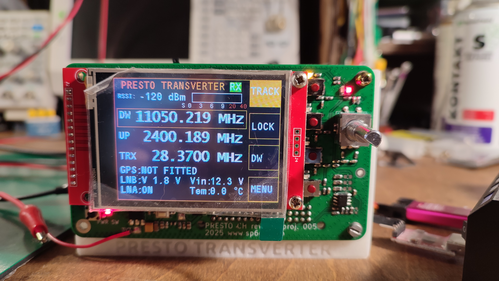

# Control head for Presto — QO-100 Transverter

**Status: Work in Progress — November 2026**

Control head unit with LCD, encoder, tactile buttons and STM32F411 microcontroller for Presto transverter.

This project includes the schematic and PCB design files, organized under the `ECAD/` directory.
Software and its documentation is in `/Software/SW__0005_PrestoCH_rev_01a//` where `MCU/` includes STM32 project and SCPI commands for remote control. 
`Documents/` includes interactive BOM and .pdf schematic.

## Features
- **Embedded firmware:** STM32F411 microcontroller running C with FreeRTOS.
- **Encoder and 4 tactile buttons** as human-machine interface
- **2.8" TFT LCD** with touchscreen and ILI9341 controller
- **Graphical interface:** Frequency control, configuration menus, and diagnostic information.
- **Remote control:** B.A.S.I.C. (Basic Automated SCPI Interpreter for Controllers) provides serial control through SCPI-like commands.
- **Built-in diagnostics:** Startup and runtime self-tests, error logging, memory integrity checks, and automatic gain control.
- **On board EEPROM:** Stores board identification data and calibration.
- **Calibration tools:** Python scripts and service commands for EEPROM programming and automated calibration.
- **ICSP port:** exposed for easy reprogramming and evaluation

## System and compatibility
This repository contains all documentation for the control head of Presto transverter. Complete system consists also requires:
- **Motherboard** Contains RF signal path and power supplies: 
- **2 x LO Module** LMX2572 LP based local oscillator module

## Project Status

**This project is actively under development and is not yet complete.**
Currently the RF path is under evaluation and characterization.
There was a known issue with ADC pin assignment, fixed with bodge wire. TODO: document fix in project.
